# gegl-presence

The "presence" controls of Lightroom and Camera Raw as GEGL operations for
GIMP 3, each a non-destructive filter (live preview, split view, editable
later in the layer's effects, kept in XCF files):

- **Clarity** (`presence:clarity`, Filters > Enhance): raises or lowers
  the contrast of mid-size detail, most in the midtones, without halos at
  strong edges.
- **Texture** (`presence:texture`, Filters > Enhance): accentuates or
  smooths medium-fine detail such as skin, bark or fabric, leaving strong
  edges, noise and smooth areas.
- **Dehaze** (`presence:dehaze`, Filters > Enhance): removes (or adds)
  atmospheric haze.
- **Whites and Blacks** (`presence:whites-blacks`, Colors): moves the
  white and black ends of the tones, with a soft roll-off so that nothing
  clips, and leaves the midtones.

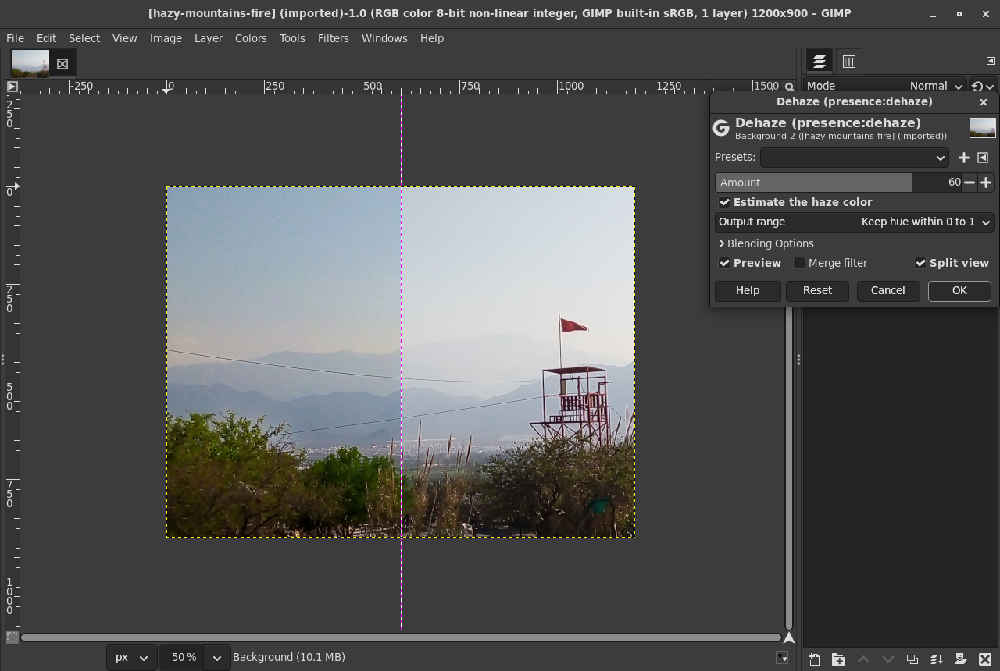

All four take one input (GIMP 3.2 makes filters with a second input
destructive), work on any precision (8, 16 and 32 bit integer, half,
float, double, linear or perceptual) and on grayscale images, keep each
pixel's colour, pass alpha through untouched, leave broken pixels (NaN,
infinity) as they are without spreading them, and give the same result
for any tile size, number of threads and requested region.

License: GPL-3.0-or-later (the detail term of Clarity and Texture comes
from darktable, GPL-3.0-or-later, and the guided filter from
gegl-underwater, the same author's, GPL-3.0-or-later).

## Why

gimp-devtools/docs/photoshop-gaps.md (item 6) and prior-art-candidates.md:
GIMP 3.2.6 has Shadows-Highlights, Retinex, Unsharp Mask and the tone
mappers, but no clarity, texture or dehaze filter; the existing ones are
all destructive: nicolasloizeau/gimp-multiscale-clahe (CLAHE at six scales,
numpy), G'MIC's afre "Local Contrast" and "Texture", Boulanger's "DCP
Dehaze". GEGL master has no clarity, texture, local Laplacian or dehaze
operation. These are editable versions, and halo-free by method.

## Using them in GIMP

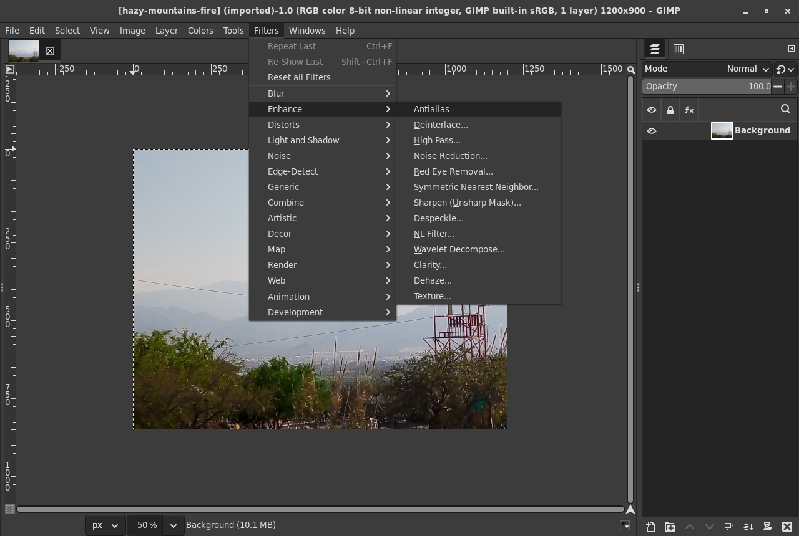

Clarity, Dehaze and Texture are at the end of Filters > Enhance, Whites
and Blacks at the end of Colors (the `gimp:menu-path` keys; the menus
checked in GIMP 3.2.6 on Broadway, tests/gui/shots.sh).

Each has an **Output range** for colours that end up outside 0 to 1:
**Keep hue within 0 to 1** (the default) moves such a colour towards the
gray of the same luminance as little as needed, so its hue stays and its
saturation gives; **Clip each channel** clips as GIMP's conversion to an
integer image would; **Unbounded** keeps the float values, for high
dynamic range work. It only matters where the filter pushes colours out
of range; at 0 every filter passes the image through exactly.

### Clarity

**Amount** -100 to 100 (0: nothing). At +100 detail of the chosen size is
about 2.4 times as strong, at -100 it is flattened to about 0.3.
**Size** (4 to 1000 pixels, 40 by default): the radius of the detail
changed most; detail from about half to three times that size is changed
strongly, smaller and larger less. Lightroom's Clarity works on a broad
band "including some lower frequencies" (Adobe, see Texture); the size
lets the band follow the photo's resolution.

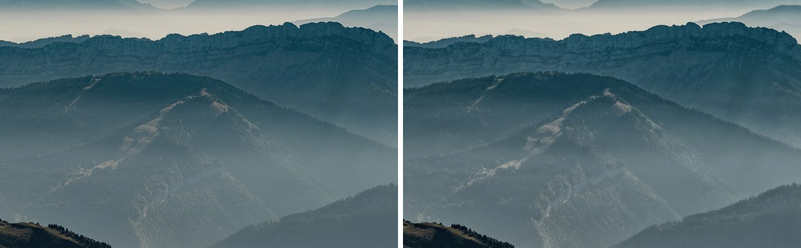

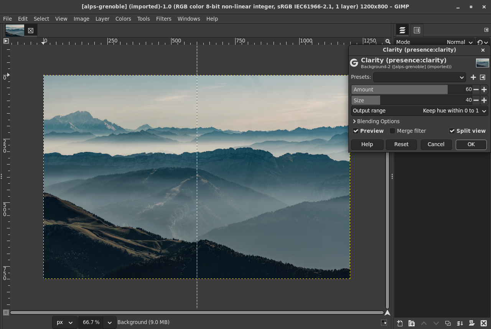

### Texture

**Amount** -100 to 100, **Size** (1 to 100 pixels, 8 by default).
Positive values accentuate the band; negative values smooth it (skin),
keeping edges (eyes, lips) as they are. When accentuating, a change
smaller than about 0.4 L* in a neighbourhood (noise in smooth areas) is
cored away, so smooth skies and walls stay smooth. Adobe describes
Texture as working on "mid-frequency features" with "the noise largely
untouched" and negative values "sometimes compared to Noise Reduction"
([From the ACR Team: Introducing the Texture Control](https://blog.adobe.com/en/publish/2019/05/14/from-the-acr-team-introducing-the-texture-control),
Max Wendt, 2019).

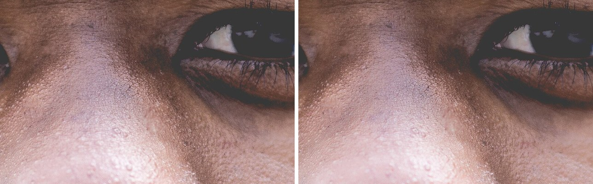

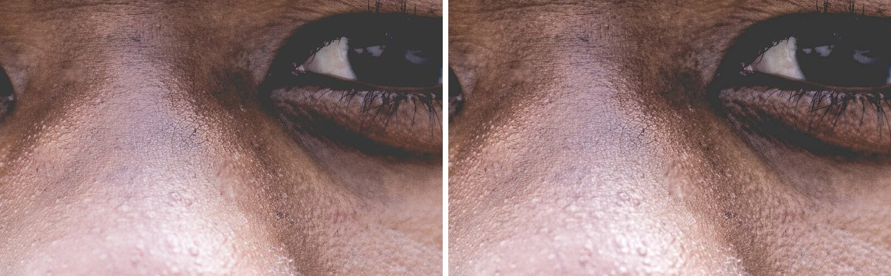

### Dehaze

**Amount** -100 to 100: positive values remove that percentage of the
haze by the haze model (100 is the model's full removal; He et al.'s own
setting is 95), negative values add haze of the same colour, more in the
distance. **Estimate the haze color** (on): the colour of the haze from
the image; turned off, **Haze color** is used, which can be picked from
hazy sky with the dialog's colour picker.

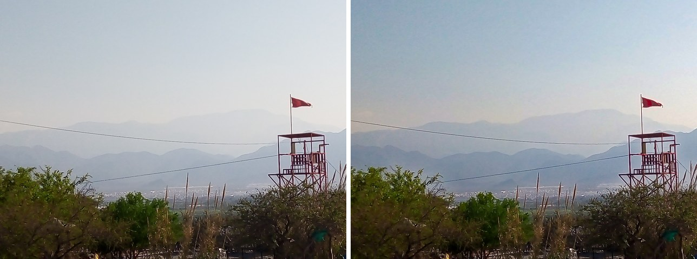

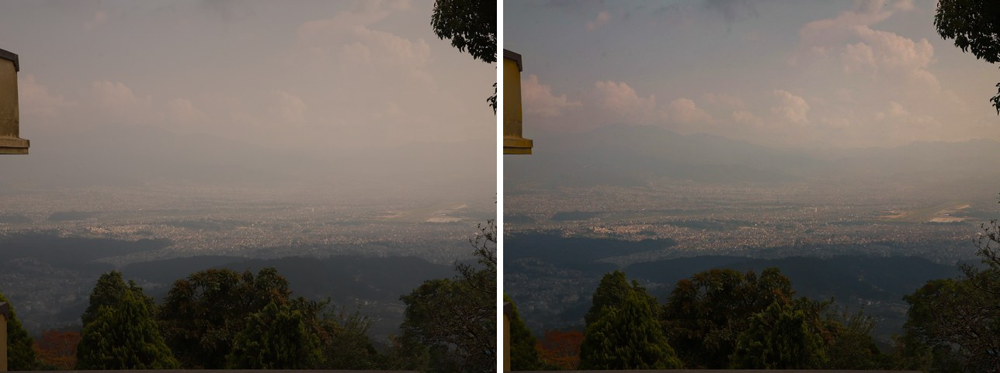

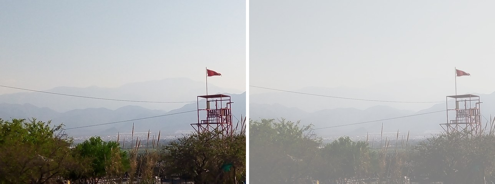

### Whites and Blacks

**Whites** -100 to 100: positive values brighten the lightest tones,
negative values darken them (white becomes light gray, L* 83 at -100).
**Blacks** -100 to 100: positive values lift the darkest tones (black
becomes L* 17 at +100), negative values deepen them. **Ends**: with
**Soft roll-off** (the default) brighter whites and deeper blacks keep
white at white and black at black and move the tones next to them
instead, so nothing clips; with **Move the end points** white goes to
L* 117 at +100 and black to L* -17 at -100, so the lightest and darkest
tones clip, as in Lightroom. The midtones (L* 50) never move.

GIMP's Shadows-Highlights (`gegl:shadows-highlights`, from darktable) is a
local filter (a blurred mask of radius 100) for shadows and highlights; its
"white point adjustment" divides L by (1 - amount), which stretches all
tones including the midtones and clips (GEGL's
`shadows-highlights-correction.c`, read for this). Whites and Blacks is a
global curve that moves only the ends, with or without clipping, and has
blacks too; the two do not overlap.

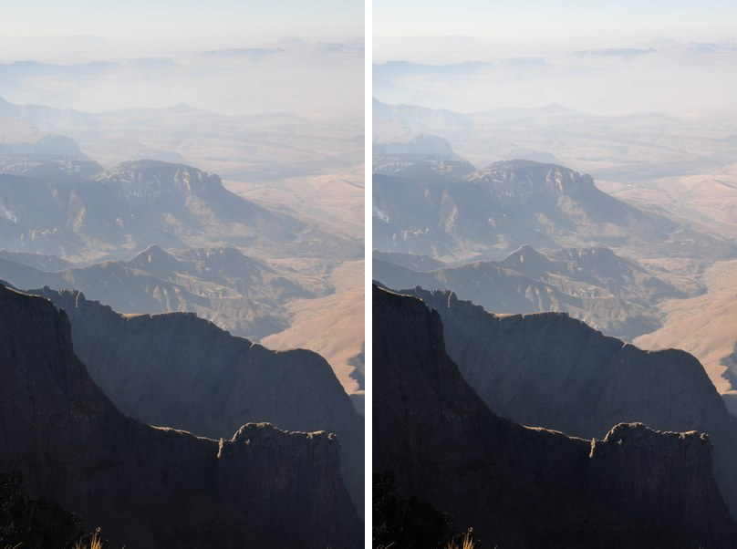

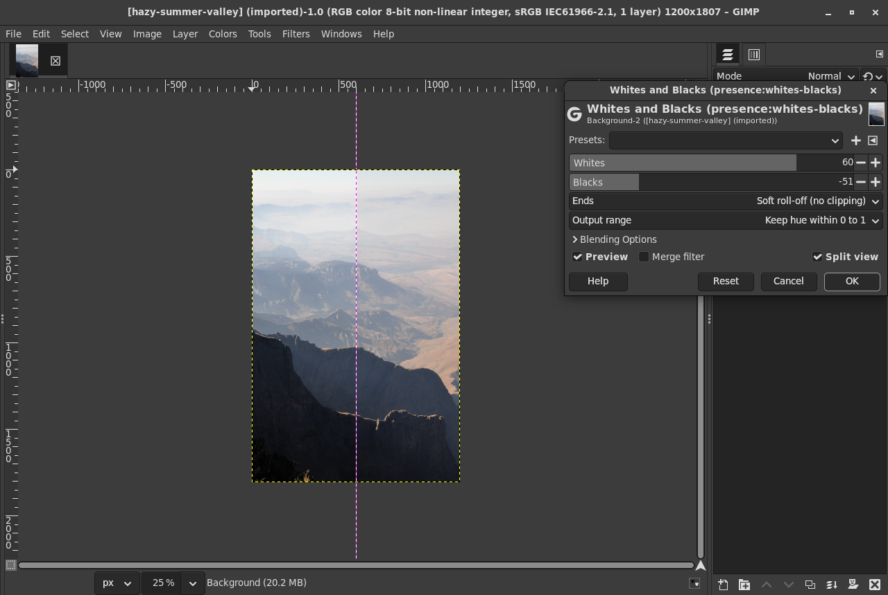

## How they work

### Lightness and colour

Clarity, Texture and Whites and Blacks change CIE lightness L* (as
L* / 100, from babl's luminance of the image's own RGB space, with the
linear part near black; defined below 0 and above 1 too), a perceptual
scale in which a step means the same everywhere. The new luminance Y2 is
given to a pixel by scaling its linear channels, which keeps its
chromaticity (hue and saturation), plus a gray part that makes up what
scaling cannot near black: out = in (Y2 + e) / (Y + e) + (Y2 - Y (Y2 + e)
/ (Y + e)), e = 0.001. The luminance is then exactly Y2 and the
chromaticity moves by at most e / (Y + e) of the way to gray (measured:
at most 0.0012 in rgb chromaticity for pixels of luminance above 0.05).
Dehaze works on linear light, where the haze model holds.

### Clarity and Texture: a band limited local Laplacian filter

The local Laplacian filter of Paris, Hasinoff and Kautz
([SIGGRAPH 2011](https://people.csail.mit.edu/hasinoff/pubs/ParisEtAl11-lapfilters.pdf))
enhances detail with a Laplacian pyramid in which each coefficient comes
from the image remapped around that pixel's own value: differences to it
smaller than a threshold are detail and are raised, larger ones are edges
and left as they are, so there are no halos. The fast form of Aubry,
Paris, Hasinoff, Kautz and Durand (ACM TOG 2014) remaps the image around a
few sampled values (one threshold apart) and interpolates each
coefficient between the two samples next to the input's value at that
level. Nothing here comes from Adobe's own code, which is not public.

The detail term is darktable's (`src/common/locallaplacian.c`,
GPL-3.0-or-later, Johannes Hanika and the darktable developers, read for
this): r(i) = i + k d exp (-d^2 / 2 s^2) with d = i - g. The code is
written anew (`operations/presence-common.h`) and differs in these ways:

- Only the change is built: a pyramid of the change is collapsed and
  added to L, so the unchanged image is never rebuilt from its pyramid.
- Each pyramid level has a weight, a Gaussian in octaves around
  log2 (size / 2.8), so that one band of sizes changes (standard
  deviation 1 octave for Clarity, 0.8 for Texture). Level l peaks at a detail radius of about
  2.8 x 2^l pixels (measured with gratings in tests/check.c).
- Clarity weights the samples towards the midtones (a Gaussian of width
  0.25 around L = 0.5): at +100 the band's gain is 2.19 at L* 50 and 1.45
  at L* 15 and 85.
- Coarse bands are remapped from a copy two levels finer than the band
  (Aubry et al., sec. 4), which is as the full image to within 0.01 L*
  at a step edge; one level finer would add a third to the overshoot.
- Texture cores the change: where its local RMS (over about 8 pixels) is
  below 0.4 L* the change is scaled by e / (e + 0.004^2) (e the local mean
  square), so noise in smooth areas is left. (A noise floor inside the
  remap, tried first, cannot work: with samples one threshold apart the
  difference is taken from the sample, not from the local mean.)

Thresholds: Clarity 0.12 (12 L*), Texture 0.06; gains at +100: 2 (the
detail term's slope, so about three times the detail at the band's centre
before the level weights), at -100: -1 (flattened).

The whole image is filtered at once (the pyramid covers it), so the
result does not depend on tiles. The pyramid is a 5-tap binomial
(1 4 6 4 1) with repeated borders.

### Dehaze: dark channel prior and guided filter

The haze model of Koschmieder, I = J t + A (1 - t), with I the photo, J
the scene without haze, A the colour of the haze (airlight) and t the
transmission, in linear light. He, Sun and Tang's dark channel prior
([CVPR 2009](https://doi.org/10.1109/CVPR.2009.5206515), TPAMI 2011): in
haze-free outdoor photos most patches have a pixel with a channel near 0,
so 1 - t is the dark channel of I / A. Here:

1. The estimates are made once for the whole image on a copy of about
   1024 pixels across (block means), so they do not depend on tiles, as in
   gegl-underwater.
2. The dark channel over a patch of radius 7 at 600 pixels (He et al.'s
   15 x 15), 12 on the copy.
3. The haze colour: the mean of the pixels of the brightest 0.1 % of the
   dark channel (He et al. take the brightest of those pixels; the mean is
   steadier), or the picked colour.
4. The dark channel of I / A, then a **maximum over the same patch** (a
   morphological opening). With the minimum alone a dark object's value
   spreads a patch wide into the haze around it and leaves a bright halo
   after the removal (seen around a tower and a flag in the Monterrey
   photo); the opening keeps outlines and still ignores bright objects
   smaller than a patch, as the prior wants.
5. t = 1 - that, refined with the guided filter (He, Sun, Tang, ECCV
   2010) on lightness, radius 2 patches, epsilon 1e-4, its coefficients
   upsampled to full size and applied to each pixel's own lightness (the
   fast guided filter, He and Sun 2015), so t follows the full-size edges.
6. Amount a > 0: t_a = 1 - a (1 - t), J = (I - A) / max (t_a, 0.1) + A.
   Amount a < 0: I' = I t_h + A (1 - t_h), t_h = t^|a| exp (-0.5 |a|):
   more haze in the distance and a little everywhere.

The Microsoft patent on the dark channel prior (US 8,340,461) lapsed for
non-payment of its fees; Adobe's dehaze patents claim other things (a
learned model, a per-pixel scaled bound, artifact suppression, video,
optical flow). See [docs/patents.md](docs/patents.md).

Limits: the dark channel prior fails on large bright objects without a
dark channel (white walls, snow) and makes them look hazy (they are
darkened); dehazing amplifies the noise and JPEG blocks of hazy skies by
1 / t (up to 10 times); the haze colour is estimated from the image's own
channels, so the same colours in another RGB space give a slightly
different result (up to 0.058 in linear light between sRGB, Adobe RGB and
ProPhoto in the checks).

### Whites and Blacks: a curve with fixed midtones

On x = L* / 100, the upper half u = 2 (x - 0.5) and the lower half
u = 2 (0.5 - x) each get a cubic that is flat at the midtones (the curve
is smooth there to the second derivative): f(u) = u + (w / 3) u^3, which
moves the end by w / 6 (w = slider / 100, turned for blacks so that
positive deepens), or with the soft roll-off for an outward move
f(u) = u + w (u^3 - u^4), which keeps f(1) = 1 (slope 1 - w there). Above
u = 1 (float colours beyond white or black) the curve continues straight
with its slope at the end. All curves are monotonic (162 settings
checked from L* -10 to 150). Soft whites +100 raise L* 75 to 78.1,
L* 90 to 95.1 and L* 97 to 99.5.

## Tests

    tests/images/fetch.py     # the CC0 and public domain photos (optional)
    tests/check.sh            # numerical checks, also under ASan and UBSan
    tests/bench.sh            # timing on 24 megapixels
    tests/gimp-check.sh       # the filters in headless GIMP
    tests/gui/shots.sh        # the dialogs on Broadway, the screenshots

Everything builds and runs inside the Flatpak GIMP's SDK
(../gimp-devtools/gimp-build.sh, with GIMP_RUN_HOME in tests/output) and
every GIMP and GEGL run goes through tests/isolate.sh (a copy of
gimp-devtools/isolate.sh), with the user's GIMP, Blender, Godot, Krita
and Tiled folders listed before and after: each script fails if anything
there changed. GUI runs use `--new-instance`.

tests/check.sh: 114 checks with the photos (108 without them; the
sanitizer build runs those): no AddressSanitizer or UBSan errors, no
leaks in this code, no leaked GeglBuffers. The measurements:

| What | Result |
|---|---|
| Identity at 0 | bit for bit, with NaN, infinities, negative and huge values |
| Tiles 32x32 to 700x16, origin 37, -21, 1 to 8 threads, three regions | identical, max difference 0 |
| Clarity +100, size 40: gain by wavelength (2 L* gratings) | 16 px 1.18, 32 px 1.73, 64 px 2.36, 128 px 2.34, 256 px 1.78, 512 px 1.30, 2 px 1.00, 2048 px 1.02 |
| Clarity peak radius for size 20, 40, 80 | 16, 32, 64 px |
| Clarity -100 / -50 at the band | gain 0.29 / 0.64 |
| Clarity at L* 15, 50, 85 | gain 1.45, 2.19, 1.45 |
| Clarity +100 overshoot at a 50 L* step | 0.69 L* (bound 1 L*); unsharp mask of the same gain and scale 49.5 L* |
| Clarity overshoot by step height (5 to 70 L*) | 2.8, 4.3, 3.3, 1.4, 0.7, 0.7 L* (small steps are detail and are raised) |
| Texture +100, size 8: gain by wavelength | 2 px 1.06, 8 px 1.57, 16 px 2.00, 32 px 1.73, 64 px 1.19, 128 px 1.01 |
| Texture overshoot at a 50 L* step | +100 0.37 L*, -100 0.05 L* |
| Texture on 0.3 L* noise / on 1.1 L* texture | times 1.01 / times 1.66 |
| Texture -100 / -50 on texture | times 0.53 / 0.76; a grating at the band's peak times 0.39 |
| Dehaze haze colour, synthetic scene (0.80, 0.85, 0.92) | 0.797, 0.846, 0.915 |
| Dehaze transmission, mean error (t 0.06 to 0.81) | 0.015 away from depth edges, 0.017 with them |
| Dehaze scene error (RMS, linear, t >= 0.2) | hazy 0.360, at 50 0.265, at 100 0.028 (0.038 with depth edges) |
| Dehaze on five hazy photos at 60: local contrast (L* std-dev in 32 px blocks) | 3.66 to 4.47, 3.39 to 3.64, 1.97 to 2.28, 1.34 to 1.68, 2.13 to 2.78 |
| ... pixels clipped to white or black | at most 0.23 % |
| Whites and Blacks end points | as designed to 0.001 L*; midtones move less than 3e-6 |
| Colour kept (rgb chromaticity, luminance above 0.05) | at most 0.0012 |
| Keep hue range | inside 0 to 1, direction from gray kept to 1 - cos 2e-10 |

The halo bound: 1 L* is well under a just noticeable difference of
colour (on average 2.3 in CIELAB, Mahy, Van Eycken and Oosterlinck,
Color Research and Application 19(2), 1994; 1.0 is the older rule of
thumb); the filters' thresholds (12 L*, 6 L*) make a 50 L* step an edge
that the remapping leaves alone, and the overshoot that is left comes
from the interpolation between samples and the pyramid.

tests/gimp-check.sh (GIMP 3.2.6 Flatpak, headless): 86 checks. Each
filter as a `Gimp.DrawableFilter` on 8, 16 and 32 bit integer, half,
float and double images and a grayscale one, saved as XCF and loaded again
(settings kept), merged, against plain GEGL on the same pixels (at most
one 8 bit step, 0 to 5e-7 in float); on a layer with offsets; and GIMP's
results equal to the `gegl` command line with the same settings (max
difference 0).

tests/gui/shots.sh: 12 checks on Broadway: the menus, each dialog in
split view (the screenshots here), and Dehaze applied with OK and saved:
after loading the XCF the layer has the live filter `presence:dehaze`
with its amount.

### Speed

tests/bench.sh, 6000 x 4000 (24 megapixels, generated), best of three,
on this machine (24 threads, GEGL 0.4.72 of the GIMP 3.2.6 Flatpak):

| Operation | 24 threads, float | 8 bit | 1 thread, float | 26 MP photo, 24 threads |
|---|---|---|---|---|
| gegl:gaussian-blur 40 (for scale) | 0.42 s | 0.47 s | 1.13 s | 0.41 s |
| gegl:unsharp-mask 40 (for scale) | 0.56 s | 0.56 s | 1.81 s | 0.53 s |
| Clarity 50, size 40 | 1.22 s | 1.28 s | 3.16 s | 0.85 s |
| Clarity 50, size 10 | 1.76 s | 1.76 s | 4.10 s | 1.14 s |
| Clarity 50, size 200 | 0.88 s | 0.85 s | 1.42 s | 0.66 s |
| Texture 50, size 8 | 2.35 s | 2.27 s | 4.27 s | 1.49 s |
| Texture -50, size 8 | 2.07 s | 2.23 s | 4.14 s | 1.46 s |
| Dehaze 50 | 0.91 s | 0.90 s | 1.35 s | 0.71 s |
| Whites and Blacks | 0.24 s | 0.29 s | 0.76 s | 0.16 s |

The 26 megapixel photo is tests/images/alps-grenoble.jpg; it is faster
than the generated image, whose tones span 0 to 1 and need more of the
local Laplacian filter's samples.

GIMP recomputes the whole image when a setting changes (every result
needs all of the image), so on a 24 megapixel photo each change of a
slider takes about as long as above.

## Building and installing

    meson setup build -Dmoduledir=$HOME/.local/share/gegl-0.4/plug-ins
    ninja -C build install

For the Flatpak GIMP, build inside its SDK and install into its folder:

    ../gimp-devtools/gimp-build.sh . meson setup build -Dmoduledir=\$GEGL_OPDIR
    ../gimp-devtools/gimp-build.sh . ninja -C build install

(`$GEGL_OPDIR` is `~/.var/app/org.gimp.GIMP/data/gegl-0.4/plug-ins`.)
Needs GEGL 0.4.62 or later.

## Credits

- Local Laplacian filters: Sylvain Paris, Samuel W. Hasinoff, Jan Kautz,
  "Local Laplacian Filters: Edge-aware Image Processing with a Laplacian
  Pyramid", ACM TOG 30(4), 2011; Mathieu Aubry, Sylvain Paris, Samuel W.
  Hasinoff, Jan Kautz, Frédo Durand, "Fast Local Laplacian Filters:
  Theory and Applications", ACM TOG 33(5), 2014.
- darktable's local contrast (local Laplacian, detail curve), GPL-3.0+.
- Dark channel prior: Kaiming He, Jian Sun, Xiaoou Tang, "Single Image
  Haze Removal Using Dark Channel Prior", CVPR 2009 and TPAMI 33(12),
  2011; guided filter: the same, "Guided Image Filtering", ECCV 2010 and
  TPAMI 35(6), 2013; Kaiming He, Jian Sun, "Fast Guided Filter",
  arXiv:1505.00996, 2015.
- Photos (tests/images/README.md): Greg Rakozy, Doggo19292, Krishna k.
  sahh, Rosan Harmens, Ju On, Dktue, William Stitt, Jeremy Bishop, Kurt
  Kaiser; CC0 and public domain, from Wikimedia Commons.
